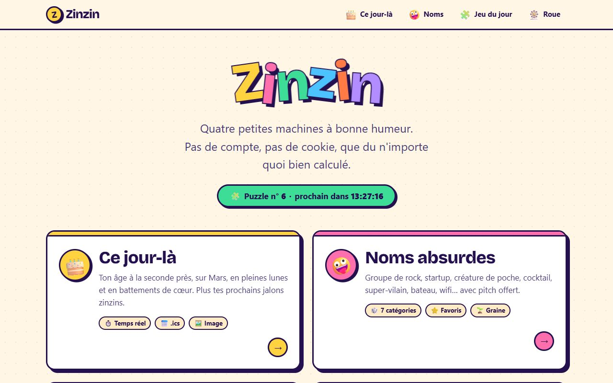
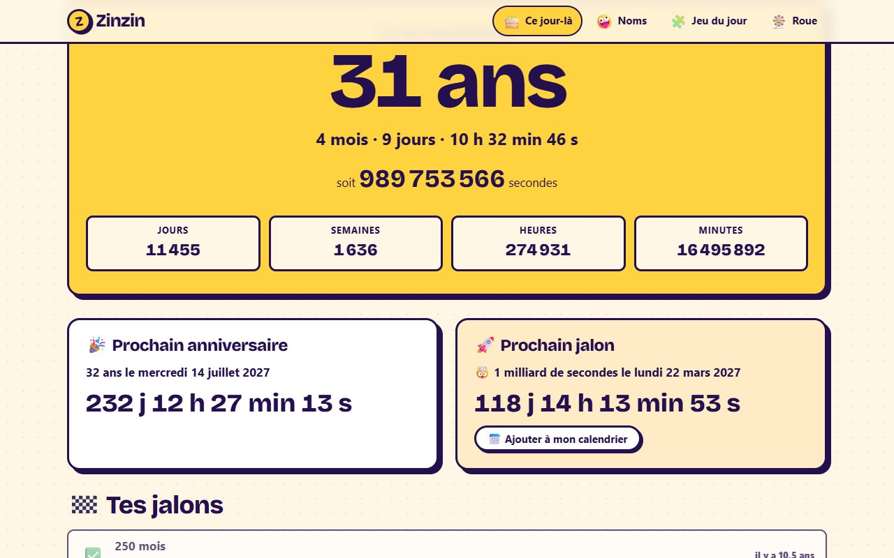
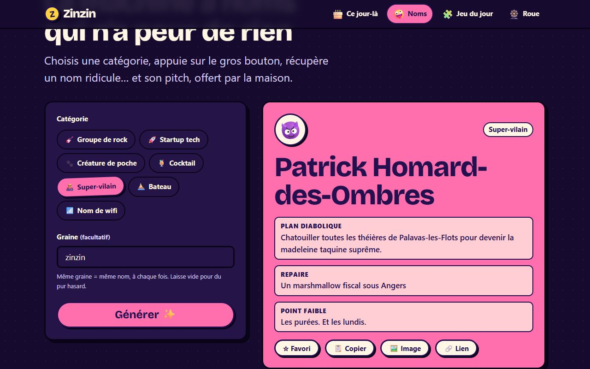
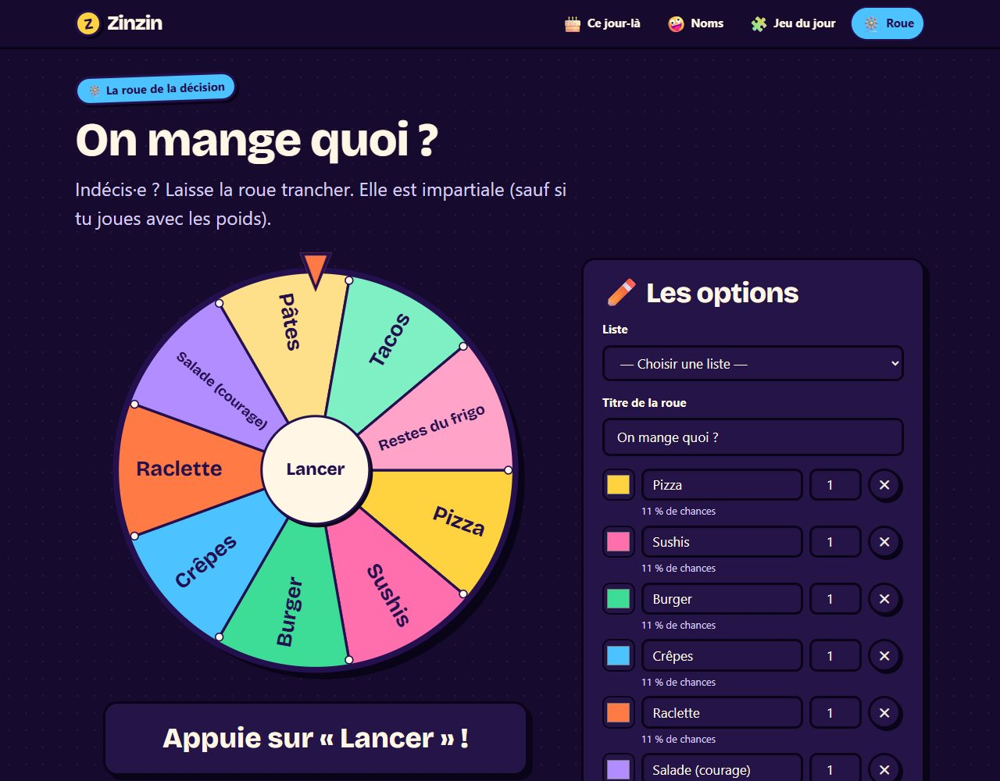

# 🤪 Zinzin

**Des mini-apps fun, 100 % statiques et 100 % en français.** Aucun compte, aucun cookie, aucun tracker : tout se passe dans ton navigateur.

👉 **https://zinzin.johan-saez-craponne.workers.dev/**



## Les apps

| | App | Ce qu'elle fait |
|---|---|---|
| 🎂 | [**Ce jour-là**](https://zinzin.johan-saez-craponne.workers.dev/ce-jour-la/) | Ton âge à la seconde (en direct), tes jalons (10 000 jours, 1 milliard de secondes…), ton âge sur chaque planète, les pleines lunes vécues (calcul astronomique), tes signes, des estimations rigolotes, un export calendrier `.ics` et une image à partager. |
| 🤪 | [**Noms absurdes**](https://zinzin.johan-saez-craponne.workers.dev/noms/) | Groupe de rock, startup, créature de poche, cocktail, super-vilain, bateau, wifi, avec un pitch généré. Accords en genre et en nombre, mode « graine » (ton prénom donne toujours le même nom), favoris. |
| 🧩 | [**Le jeu du jour**](https://zinzin.johan-saez-craponne.workers.dev/jeu/) | **Émojifilm** : un film en émojis (221 films). **Silhouette** : un pays à sa forme (229 pays, distance, direction et proximité). Même puzzle pour tout le monde, nouveau chaque jour à minuit (heure de Paris), stats, séries, partage sans spoiler. |
| 🎡 | [**La roue de la décision**](https://zinzin.johan-saez-craponne.workers.dev/roue/) | Roue animée avec options pondérées, 3 thèmes sonores, confettis, listes prêtes à l'emploi, listes perso partageables par lien, modes « éliminer » et « tournoi », tirage d'équipes. |

**Et aussi :** 🎄 [Calendrier de l'Avent](https://zinzin.johan-saez-craponne.workers.dev/avent/) · 🎅 [Père Noël secret](https://zinzin.johan-saez-craponne.workers.dev/pere-noel-secret/) (tirage sans serveur, liens chiffrés) · ⭐ [Album d'autocollants](https://zinzin.johan-saez-craponne.workers.dev/album/) (succès dans toutes les apps) · 🔮 [Horoscope absurde](https://zinzin.johan-saez-craponne.workers.dev/horoscope/) · 🧀 [Quiz](https://zinzin.johan-saez-craponne.workers.dev/quiz/) · ⏱️ [Chrono parfait](https://zinzin.johan-saez-craponne.workers.dev/chrono/) · 👥 [Équipes & dés](https://zinzin.johan-saez-craponne.workers.dev/equipes/) · 🙊 [Excuses bidon](https://zinzin.johan-saez-craponne.workers.dev/excuses/).

Le jeu du jour compte aussi **Émojichanson** et **Plus ou moins**, des **archives**, des **défis entre amis** et un **mode difficile**. Thème clair/sombre automatique ou manuel (bouton 🌗), et un petit secret pour qui connaît le code Konami.

| Ce jour-là | Noms absurdes |
|---|---|
|  |  |

| Le jeu du jour (mobile) | La roue (thème sombre) |
|---|---|
|  |  |

## Points forts

- **Zéro dépendance au runtime** : HTML, CSS et JavaScript vanilla (modules ES), sans framework, sans bundler et sans CDN. La police est auto-hébergée.
- **Mobile d'abord**, thème sombre automatique, animations désactivées si `prefers-reduced-motion`.
- **Accessible** : navigation au clavier, ARIA (onglets, combobox, `aria-live`), focus visible. Lighthouse 100 en accessibilité.
- **Rapide** : Lighthouse ≥ 90 partout en performance, et 100 en bonnes pratiques et en SEO.
- **Hors ligne** : service worker, installable comme une app (PWA).
- **Sécurisé** : CSP stricte (`script-src 'self'`, `style-src 'self'`), aucun script ni style inline.
- **Testé** : plus de 100 tests unitaires avec le test runner natif de Node (dates, astronomie, RNG à graine, accords, géographie, tirage pondéré…).

## Lancer en local

Prérequis : [Node.js](https://nodejs.org/) ≥ 20 (seulement pour les tests et les scripts : le site n'a pas d'étape de build).

```bash
npm install        # dépendances de développement (scripts, tests navigateur, déploiement)
npm run serve      # http://localhost:3000
npm test           # tests unitaires (node --test)
npm run check      # vérification de toutes les pages dans Edge/Chrome (mobile/desktop, clair/sombre)
```

Le site servi est entièrement dans [`public/`](public/). Tu peux aussi le servir avec n'importe quel serveur statique (`npx serve public`).

### Scripts de données (à lancer seulement si besoin)

| Commande | Rôle |
|---|---|
| `npm run data` | Régénère `public/jeu/data/pays.json` depuis Natural Earth (paquet `world-atlas`) |
| `node scripts/build-og.mjs` | Régénère les images de partage (Open Graph) et les icônes |
| `node scripts/seo-meta.mjs` | Met à jour les balises SEO de chaque page, `sitemap.xml` et `robots.txt` |

## Déploiement

Le site est hébergé sur **Cloudflare** (Worker avec fichiers statiques, configuré dans [`wrangler.jsonc`](wrangler.jsonc)) :

```bash
npm run deploy     # envoie public/ sur Cloudflare (wrangler doit être connecté : npx wrangler login)
```

Les en-têtes de sécurité et de cache sont dans [`public/_headers`](public/_headers), les raccourcis d'URL dans [`public/_redirects`](public/_redirects).

**Déploiement automatique (optionnel)** : dans le tableau de bord Cloudflare, *Workers & Pages* → Worker `zinzin` → *Settings* → *Builds* → *Connect*, puis choisir le repo GitHub, la branche `main`, une commande de build vide et la commande de déploiement `npx wrangler deploy`. Chaque `git push` redéploiera alors le site.

Le site fonctionne aussi tel quel sur **Cloudflare Pages** (framework « None », commande de build vide, répertoire de sortie `public`) ou sur n'importe quel hébergeur statique.

## Vie privée

Aucun cookie ni tracker, et aucune requête vers un autre site. Les favoris, statistiques et listes sont stockés dans le `localStorage` de ton navigateur et peuvent être effacés depuis la page [À propos](https://zinzin.johan-saez-craponne.workers.dev/a-propos/).

## Crédits

- Police **Bricolage Grotesque** (Atelier Triay), licence SIL Open Font License 1.1.
- Formes des pays : **Natural Earth** (domaine public), via [world-atlas](https://github.com/topojson/world-atlas).
- Calculs astronomiques : Jean Meeus, *Astronomical Algorithms*.

---

Pour les développeurs et les assistants IA : la documentation technique complète (architecture, conventions, décisions, roadmap) est dans [`CLAUDE.md`](CLAUDE.md).
